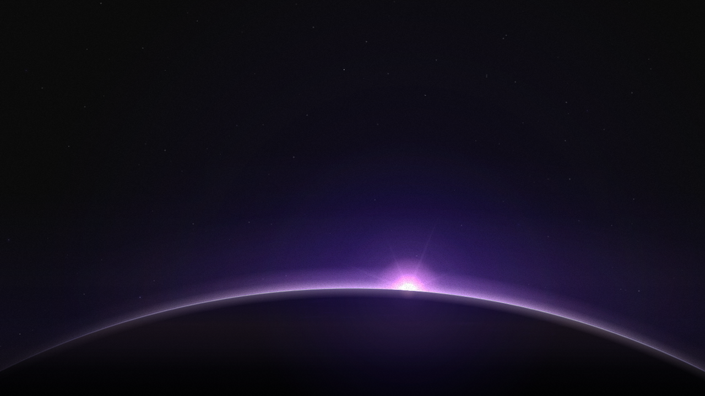
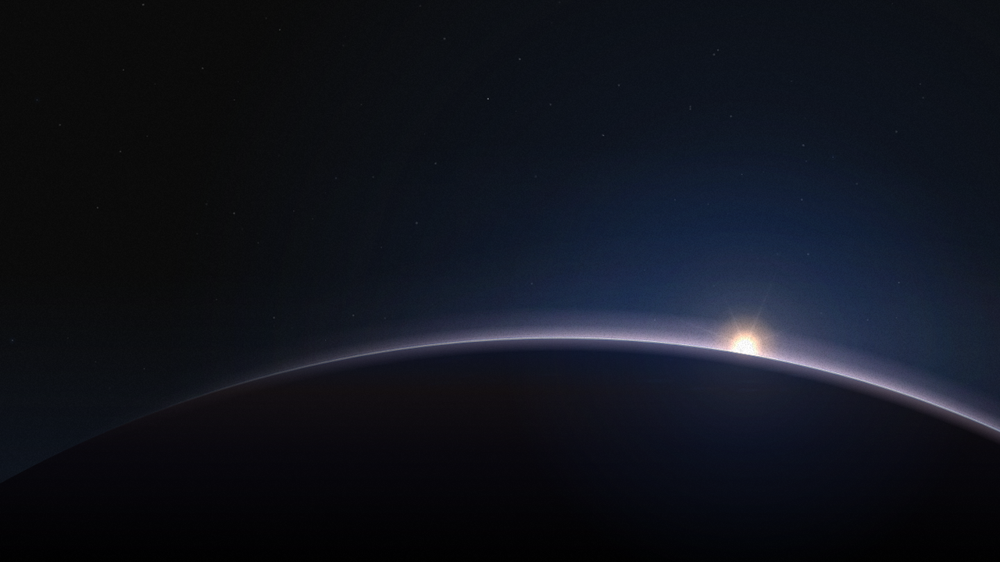
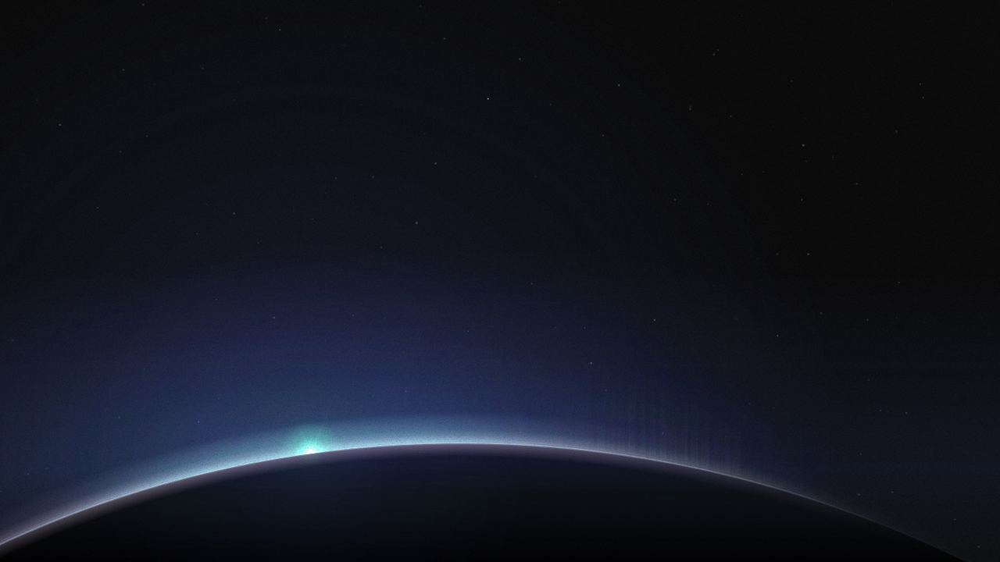
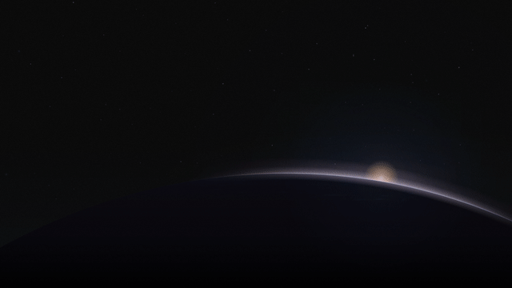
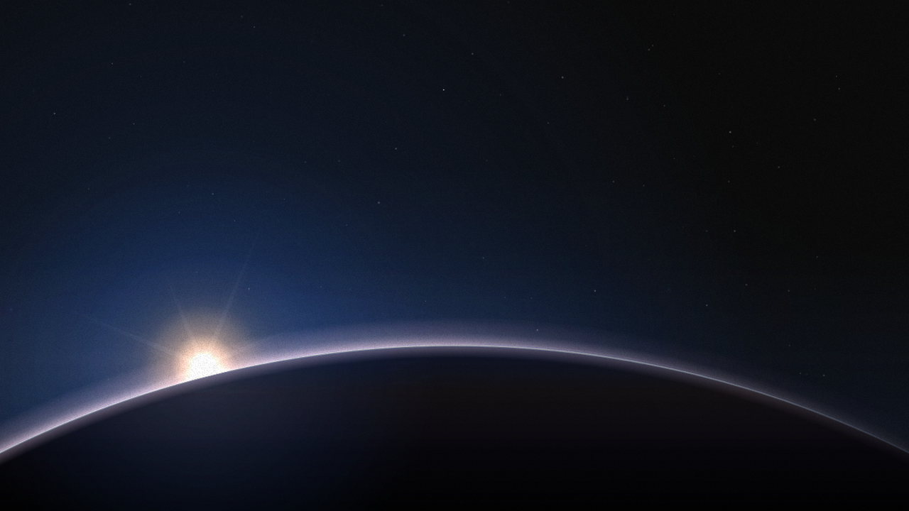
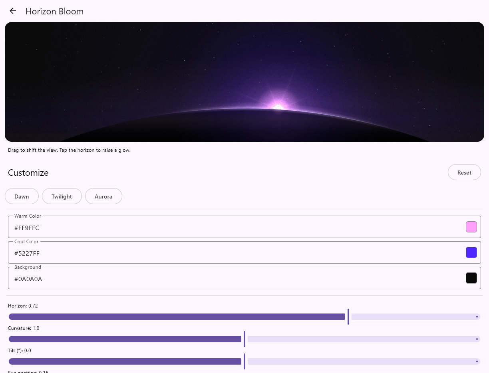

# Horizon Bloom

A configurable sunrise over a curved planetary horizon, built with **Compose Multiplatform**.

**Android · Desktop/JVM · iOS** · [Explore presets](#explore-presets) · [Run the demo](#run-the-demo) · [Effect reference](docs/EFFECTS.md)

Horizon Bloom combines atmospheric light, a glowing sun, aurora, stars, clouds, and subtle lens effects in a single Compose scene. Drag to shift the view; tap to trigger an aurora glow. Every effect can be adjusted independently.

> **Latest release:** [`v0.1.0`](https://github.com/Velord/HorizonBloom/releases/tag/v0.1.0) · [Available on Maven Central](https://central.sonatype.com/artifact/io.github.velord/horizon-bloom/0.1.0).

[](docs/media/horizon-presets.mp4)

*Dawn → Twilight → Aurora → custom · [Watch in full resolution](docs/media/horizon-presets.mp4)*

## Preview

| Dawn | Twilight | Aurora |
| :---: | :---: | :---: |
|  |  |  |

Every preview above was captured from the actual Compose renderer. These are
showcase variants derived from presets, not untouched preset defaults. They vary
sun placement, size, horizon height, and light while keeping planet curvature
consistent.

## Get started

The upcoming **0.1.1 release** (not yet published) will use the shared Maven group
`io.github.velord.horizonbloom`. After that release is available, add the
renderer (`core`) to your Kotlin Multiplatform module's `build.gradle.kts`:

```kotlin
commonMain.dependencies {
    implementation("io.github.velord.horizonbloom:core:0.1.1")
}
```

Render it anywhere inside a Compose UI:

```kotlin
import androidx.compose.foundation.layout.fillMaxSize
import androidx.compose.ui.Modifier
import com.velord.horizonbloom.HorizonBloom
import com.velord.horizonbloom.HorizonBloomConfig

HorizonBloom(
    config = HorizonBloomConfig.DAWN,
    modifier = Modifier.fillMaxSize(),
)
```

## Explore presets

Expand a preset to see a ready-to-use configuration. For a **live, adjustable scene**, use the [demo application](#run-the-demo).

<details open>
<summary><strong>Dawn</strong> — pink sunlight and a violet horizon</summary>

```kotlin
HorizonBloom(config = HorizonBloomConfig.DAWN)
```

</details>

<details>
<summary><strong>Twilight</strong> — warm sunlight against a blue horizon</summary>

```kotlin
HorizonBloom(config = HorizonBloomConfig.TWILIGHT)
```

</details>

<details>
<summary><strong>Aurora</strong> — teal light, blue atmosphere, and automatic aurora</summary>

```kotlin
HorizonBloom(config = HorizonBloomConfig.AURORA)
```

</details>

All presets are ordinary `HorizonBloomConfig` values. Use `copy()` to fine-tune them:

```kotlin
val config = HorizonBloomConfig.AURORA.copy(
    flare = 0.4f,
    stars = 1.0f,
    speed = 0.7f,
    interactive = true,
)

HorizonBloom(config = config)
```

<details>
<summary><strong>Try a small preset switcher in your app</strong></summary>

This optional example uses Compose Material 3 buttons:

```kotlin
import androidx.compose.foundation.layout.Column
import androidx.compose.foundation.layout.Row
import androidx.compose.foundation.layout.fillMaxWidth
import androidx.compose.foundation.layout.height
import androidx.compose.material3.Text
import androidx.compose.material3.TextButton
import androidx.compose.runtime.Composable
import androidx.compose.runtime.mutableStateOf
import androidx.compose.runtime.remember
import androidx.compose.ui.Modifier
import androidx.compose.ui.unit.dp
import com.velord.horizonbloom.HorizonBloom
import com.velord.horizonbloom.HorizonBloomConfig

@Composable
fun HorizonSample() {
    val configState = remember { mutableStateOf(HorizonBloomConfig.DAWN) }

    Column {
        Row {
            TextButton(onClick = { configState.value = HorizonBloomConfig.DAWN }) {
                Text("Dawn")
            }
            TextButton(onClick = { configState.value = HorizonBloomConfig.TWILIGHT }) {
                Text("Twilight")
            }
            TextButton(onClick = { configState.value = HorizonBloomConfig.AURORA }) {
                Text("Aurora")
            }
        }

        HorizonBloom(
            config = configState.value,
            modifier = Modifier.fillMaxWidth().height(280.dp),
        )
    }
}
```

</details>

## See adjustments in motion

[](docs/media/horizon-tuning.mp4)

*Sun position, size, horizon, atmosphere, spread, bloom, sunburst and flare adjusted live · [Watch the full video](docs/media/horizon-tuning.mp4)*

The custom scene derives from Twilight with a shifted sun and tuned light:



## Run the demo

The included demo lets you switch presets, edit colors, adjust effect strengths,
pause animation, and test pointer interaction. The interactive editor is an
optional, separately publishable Compose Multiplatform artifact. Once version
0.1.1 is released, add it to `commonMain`:

```kotlin
commonMain.dependencies {
    implementation("io.github.velord.horizonbloom:demo:0.1.1")
}
```

Call `HorizonDemoApp(onBackClick)` from your Compose navigation host. The demo
resolves the matching `core` artifact transitively; you do not need to declare
both unless you also consume `core` directly. Version 0.1.0 contains only the
original renderer; the new coordinates are prepared for 0.1.1.



| Platform | Run |
| --- | --- |
| Desktop | `./gradlew :demo-desktop:run` |
| Android | `./gradlew :demo-android:installDebug`, then launch **Horizon Bloom** |
| iOS | Open `iosApp/HorizonBloomDemo.xcodeproj` in Xcode and run the `HorizonBloomDemo` scheme |

Building from source requires **JDK 21**; Android also needs an Android SDK, and iOS requires macOS with Xcode.

## What you can customize

| Area | Configuration |
| --- | --- |
| Geometry | Horizon, curvature, tilt, sun position and size |
| Lighting | Sunrise, atmosphere, thickness, spread, rim, bloom, flare, sunburst, airglow |
| Environment | Aurora, stars, clouds, grain |
| Motion & input | Speed, drift, parallax, pause, intro, interaction |
| Color | Warm, cool, and background colors |

Set `interactive = false` to disable tap and drag input. See the [effect reference](docs/EFFECTS.md) for how each control affects the renderer.

**Supported targets:** Android (API 26+), Desktop/JVM, iOS ARM64 devices, and Apple Silicon iOS simulators.

## License

[Apache License 2.0](https://www.apache.org/licenses/LICENSE-2.0).
Source and demo are in this repository. The `:horizon-bloom` and `:demo`
modules are intended for Maven Central. See the
[publishing guide](docs/PUBLISHING.md) for the release process.
